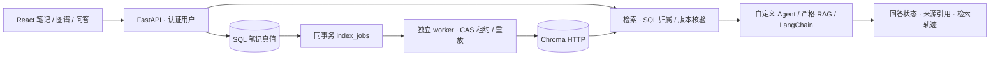

# Knowledge Base · 可评测、可恢复的 RAG 知识库

[](https://github.com/happiness-cheng/knowledge-base/actions/workflows/ci.yml)

把 Markdown 笔记组织成知识图谱，通过带来源引用的问答检索知识。项目重点是两个实际问题：**检索命中了文档，答案证据为什么仍然缺失？笔记更新成功后，向量索引如何可靠地跟上？**

**Python / FastAPI / SQLAlchemy / Alembic / BGE / Chroma / LangChain / React**

[快速复现](#快速复现) · [实验与故障案例](docs/project-evidence.md) · [完整使用说明](README_zh.md) · [Agent / Paper 配套项目](https://github.com/happiness-cheng/ai-trader)

## 项目看点

| 问题 | 实现 | 可查证结果 |
|---|---|---|
| 文档命中掩盖了缺少答案片段 | 冻结语料、gold 证据区间与 development/heldout；分开测文档召回、上下文覆盖和回答支持性 | 同模型/预算的切片对照：必需区间 **26/42 → 34/42**，保留退化题 |
| 正文 480 token，拼上标题仍超过 BGE 512 窗口 | 按真实 tokenizer 检查完整 embedding 输入；动态再切片，encode 前再次校验 | 长标题样本 **565 → 512/138 token**，正文完整保留 |
| SQL 已保存，后台任务退出或旧块仍残留 | 同事务登记索引任务；generation/CAS 租约、有限重试和幂等重放 | 缩短/删除、写成后响应丢失、旧任务完成等故障回归 |
| 独立 worker 写入后，长驻读进程的 Chroma query 仍陈旧 | API / worker 共享 Chroma HTTP 服务；SQL 再核验 owner 与内容指纹 | 真 SQL + **6 个独立 worker 进程**验证更新/删除；停存储服务后 ready 503 |

当前本地验证（2026-10-15）：**后端 440 项通过**、持久索引相关 **7 个模块 mypy 通过**、前端 Vite 构建通过。命令与范围见[验证记录](docs/project-evidence.md#验证与复现)。

## 系统如何工作



- **产品入口**：笔记编辑与导入、标签、知识图谱、带来源跳转的聊天。
- **数据边界**：认证身份决定检索用户；向量 metadata 只是候选，进入模型前再次检查当前 SQL 归属、正文和指纹。
- **索引一致性**：保存笔记与登记任务共用 SQL 事务；Chroma 副作用可重放，仍是最终一致性，不冒充分布式事务。
- **回答边界**：严格模式限制可用证据和引用来源；引用 ID 合法与每个事实得到支持分开验收，缺证据可以拒答。

## 用实验决定哪些组件值得启用

16 篇冻结技术笔记、36 道模拟题（27 正例 / 9 负例）。问题由读过原文的 agent 编写，17 development / 19 heldout；**预留组不是独立盲测**。

| 对照 | 实测 | 决策与解释 |
|---|---|---|
| fixed 480 / heading 480 | 1536 证据 token、20 候选：**26/42 / 34/42**；整题证据齐全 **15/27 / 20/27** | 标题策略净增 8 个区间，也有 3 题退化；不把证据覆盖写成回答正确率 |
| dense / BM25 / RRF | **34/42 / 33/42 / 35/42**；三者文档 Hit@3 都为 1 | 词法/语义互补，但融合也会挤掉部分证据；保留显式候选 |
| RRF + reranker | 720 个真实 pair；20-pair CPU 推理中位 **35.197s**，匹配 pool5/20 的 heldout 区间均 **11/17 → 11/17** | 当前收益与成本不匹配，默认关闭；5/10 的分数由 20-pair 派生，不报告独立推理时延 |
| 1536 预算，邻居 off / on | **35/42 / 33/42** | 邻居挤占其他证据，未作为业务默认 |
| strict Agent / LangChain | 5 题 × 2 链真实 DeepSeek 对照，识别出“supported + 合法引用”仍缺少事实支持的 CR07 | 流程/提示/工具轮次不同，不归因为框架名称，也不报 100% 语义正确率 |
| 原生检索 → 真实回答 | 16 篇 / 229 块，业务 BGE + Chroma HTTP + SQL 核验 + LC；5 次 DeepSeek 请求，4 supported / 1 拒答，逐事实记录可核查 | 小规模开发链路验收；源感知复核，不能包装为系统准确率或独立盲测 |

切片对照使用真实归一化 BGE 向量与精确内积；实验切片候选和业务切片实现分别验证，不等于生产 ANN 或端到端生成收益。[原始报告、负结果与复现入口 →](docs/project-evidence.md)

[原生回答验收](docs/2026-10-17-native-rag-validation.md)保留实际证据、提示哈希、逐请求用量和逐事实复核；CR07本轮检索到关键段，回答有对应支持，但新旧批次不是受控的单变量比较。

## 默认实现与实验候选

| 当前入口 | 状态 |
|---|---|
| 业务标题切片、完整 embedding 输入保护、SQL owner/版本核验 | 默认实现；旧索引需要显式重建才获得新表示 |
| 自定义 Agent | 聊天 API 默认 backend；strict `kb_only` 显式启用 |
| LangChain 固定 RAG | 显式选择 `backend=langchain, kb_only=true` |
| dense / BM25 / hybrid、query rewrite、rerank | LC 可选；默认 `retrieval_mode=current`，rewrite / rerank 关闭 |
| 邻居扩展、2048 证据预算 | 离线实验，不替换业务默认 |
| API 与独立索引 worker | 共用显式 HTTP 存储；production 配置禁止回退本地库 |

## 快速复现

先运行不依赖 API Key、个人数据库或模型下载的工程回归。以下是 Windows / Python 3.12 的已验证环境约束：

```powershell
git clone https://github.com/happiness-cheng/knowledge-base.git
cd knowledge-base
py -3.12 -m venv .venv
.venv/Scripts/python.exe -m pip install -r backend/requirements.txt -c backend/constraints.verified-win-py312.txt
.venv/Scripts/python.exe -m pip install pytest httpx ruff mypy -c backend/constraints.verified-win-py312.txt
cd backend
../.venv/Scripts/python.exe -X utf8 -m eval.offline_tests --verify-isolation
../.venv/Scripts/python.exe -X utf8 -m eval.offline_tests --empty-model-cache tests -q --tb=short
```

`eval.offline_tests` 隔离个人配置、使用临时状态，并阻断进程内外网访问。测试中 loopback 服务仍可通信；它不是任意子进程的网络沙箱。

真实索引测试会自动启动并关闭本机临时 Chroma HTTP 服务，与生产连接方式一致；无需预先部署。10/16—17 已复现内存客户端在缓存压力下的向量读取故障，并增加回归；加入原生回答验收入口检查后，当前后端 **450 项通过**。[故障、取舍与验证范围](docs/2026-10-17-index-test-storage-boundary.md)。

启动笔记应用、配置索引 worker、运行真实缓存模型实验，见[使用与复现](README_zh.md)。安装依赖需要网络；离线回归本身无需在线模型。

## 代码阅读路线

| 想看什么 | 入口 |
|---|---|
| 完整 embedding 输入预算 | [embedding_input.py](backend/app/services/embedding_input.py) / [切片回归](backend/tests/test_embedding_input_budget.py) |
| 持久索引任务与独立 worker | [index_jobs.py](backend/app/services/index_jobs.py) / [index_worker.py](backend/app/services/index_worker.py) |
| Chroma 进程边界修复 | [index_store.py](backend/app/services/index_store.py) / [复现与取舍](docs/2026-10-14-chroma-process-boundary.md) |
| SQL 真值与证据新鲜度 | [evidence_freshness.py](backend/app/services/evidence_freshness.py) / [版本边界测试](backend/tests/test_evidence_version_boundary.py) |
| 固定 RAG 链与改写保护 | [langchain_rag.py](backend/app/services/langchain_rag.py) / [query_rewrite.py](backend/app/services/query_rewrite.py) |
| 检索与上下文实验 | [retrieval_candidates.py](backend/eval/retrieval_candidates.py) / [实验记录](docs/project-evidence.md) |

## 验证范围

这是具备本地故障验证和可复现评测的项目，尚未宣称线上部署、生产 SLA 或独立人工语义评测通过。原实例迁移与旧索引重建需要单独实施；MySQL 并发、多主机 writer、Chroma RPC deadline 和长期负载不在当前验收范围。旧 28 题召回数字属于历史实验，不能与当前 36 题证据覆盖直接拼接。

历史设计记录保留各自时间点的状态；当前入口与结果以本 README 和[证据页](docs/project-evidence.md)为准。

[MIT License](LICENSE)
